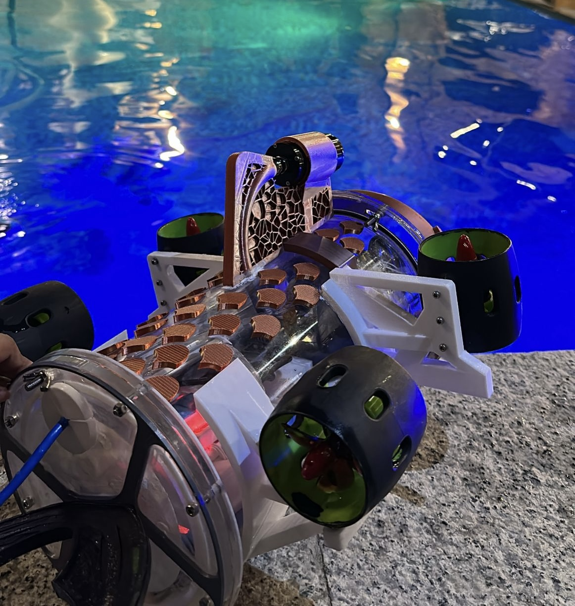

  

# 🐠 Aquaventure
### Bio-Inspired Cooperative UUVs for Seafloor Monitoring

**🥇 1st Place — University Graduation Projects Competition**
**🎓 BSc Computer Engineering — Taif University**
**_Supervised by Prof. Faris Almalki**

 

 

---

## 📖 Overview

**Aquaventure** is an integrated AI perception system for autonomous underwater vehicles (UUVs) designed to map and monitor the seafloor environment.

By merging **YOLOv8 object detection** with a **real-time monocular V-SLAM pipeline**, the system provides a unified dashboard that detects underwater objects while simultaneously generating live 3D maps of the environment. Validated through real-world pool testing against manually labeled ground truth.

---

## 🎥 Demo Videos

<table>
<tr>
<td width="50%" align="center">

### 🎬 3D Project Overview
*An animated walkthrough of the system architecture and 3D environment.*

**[▶️ Watch on YouTube](https://youtu.be/2RvsfU3mTB0)**

</td>
<td width="50%" align="center">

### 🌊 Real-World Implementation
*Behind-the-scenes: Actual pool testing and live sensor validation.*

**[▶️ Watch on YouTube](https://youtu.be/Gtdo9_rZgNs)**

</td>
</tr>
</table>

---

## 📰 Press Coverage

 

> **"طالبات سعوديات يبتكرن غواصة ذكية لرصد بيئة البحر الأحمر"**
> *"Saudi female students invent a smart submarine to monitor the Red Sea environment"*

**Featured in Al-Madina Newspaper** — one of Saudi Arabia's leading publications.

[**📖 Read Full Article**](https://www.al-madina.com/article/994583)

---

## 👩‍💻 My Role

**AI & Computer Vision Lead** — Responsible for the core perception pipeline:

- **YOLOv8 Object Detection:** Trained, fine-tuned, and integrated the model for real-time underwater target identification.
- **Monocular V-SLAM:** Implemented the Visual SLAM algorithm using Python for live 3D mapping and localization.
- **Perception Dashboard:** Merged both streams into a unified web interface for live visualization.
- **Validation:** Evaluated model accuracy against manually labeled ground truth during real-world pool testing.

---

## 🛠️ Tech Stack

| Category | Technologies |
|:---|:---|
| **AI & Vision** | YOLOv8, Roboflow, Monocular V-SLAM |
| **Programming** | Python, C++ |
| **Dashboard & UI** | React, JSX, CSS |

---

## 🏆 Achievements

- 🥇 **1st Place** — University Graduation Projects Competition
- 📰 **Featured in Press** — Al-Madina Newspaper
- 🎓 **First-Class Honors** — GPA 3.85/4.0

---

## 👥 Team & Acknowledgments

This project was developed as a Graduation Project at Taif University, supervised by **Prof. Faris Almalki**.

---

### ⭐ If you find this project interesting, please consider giving it a star!

*Built with passion for AI, Computer Vision, and Ocean Exploration.*

