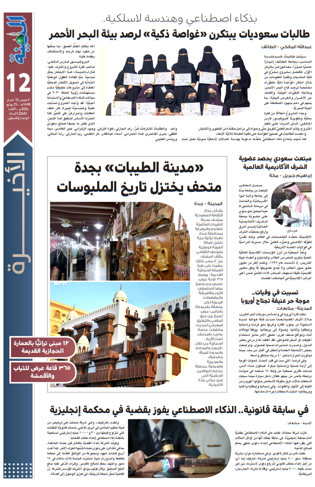

---

## 📰 Featured In

<table>
<tr>
<td width="60%" align="center">

</td>
<td width="40%" align="left">

<h3>📰 صحيفة المدينة</h3>

<b>"طالبات سعوديات يبتكرن غواصة ذكية لرصد بيئة البحر الأحمر"</b>

  

📅 العدد 21841 
🗓️ 2 محرم 1448هـ 
🇸🇦 صحيفة المدينة — السعودية

  

</td>
</tr>
</table>

---
